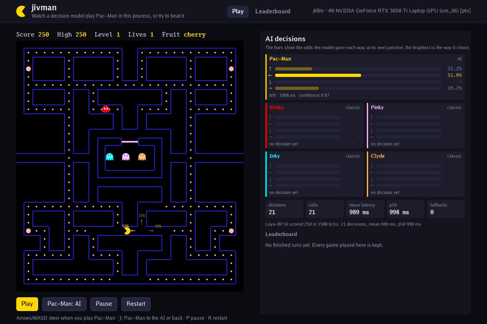

# jivman

Pac-Man played by a decision model running inside the process. Pick a model,
press Play and watch it steer Pac-Man against the classic arcade ghosts; or
play him yourself with the arrow keys; or play him against the model's ghosts.

jivman is a Go re-implementation of **[jevman](https://github.com/joch/jevman)**
by Johnny Chadda ("jevman: AI decision models play Pac-Man", r/LocalLLaMA).
jevman asks hosted System One models (TypeSafe's jev, Clef, Kev, Laya, GPT-6
Luna Decisions through Opper) over HTTP. jivman asks the same questions of a
decision model that [jitllm](../../README.md) runs in this process, on the
best device the machine has, and draws the game with
[gogpu](https://github.com/gogpu) (the toolkit the jitllm desktop app uses).

jevman is licensed under the GNU AGPL v3; jitllm is Apache 2.0. No jevman code
or asset is copied here: the game rules (the arcade's), the request's shape
(TypeSafe's System One body, with jevman's field names) and the page's look
(its palette and layout) are re-created from scratch, the board from drawing
primitives and the question text in this example's own words.

## Run it

    cd examples/jivman
    go run . -models /path/to/models

The picker lists every `.jlm` under `-models` whose container states a
decision readout: Laya, d1-3B, Lev, Clef-Flash (convert one with
`jitllm convert`; see [docs/design/decision-models.md](../../docs/design/decision-models.md)).
`-models` defaults to the CLI's models folder (`$JITLLM_MODELS`, else jitllm's
folder in the system's data directory). `-devices` places the model as the CLI
does (`auto` takes the best card and falls back to the host).

Keys: arrows or WASD steer when you play Pac-Man, `J` hands Pac-Man to the AI
or takes him back, `P` pauses, `R` ends the game and opens the Play dialog,
Enter or Space plays.

Without a window:

    go run . -headless -model laya -ticks 3600     # one game, the score, the board
    go run . -headless -model greedy               # the fixed rule, as a baseline
    go run . -headless -model laya -shot out.png   # and the last frame as a picture

## What it does, and how it maps to jevman

| | jevman | jivman |
|---|---|---|
| game | the arcade maze, 244 pellets, four power pellets, fruit at 70 and 170 pellets, scatter/chase schedule, Blinky/Pinky/Inky/Clyde targeting, three lives, levels | the same rules, re-implemented in `game/` |
| the model | hosted, over HTTP (Opper or TypeSafe) | jitllm in process: `model.Open`, `Model.NewDecider`, `Decider.Decide` -- the path `/v1/systemone` and `jitllm decide` take |
| the request | `{"state": board and actors, "questions": {"pacman": choice, ...}}`, one choice question per character at its next junction, options the legal directions with computed facts (distances to pellets, ghosts, fruit, DANGER and TRAP routes); Pac-Man's mid-corridor escape question | the same shape and fields; the question text is this example's |
| when it asks | as soon as a character commits to a corridor, all open questions in one request, up to three in flight; waits at the junction, greedy fallback after 2 s | the same, one request in flight (a Decider answers one request at a time), `-timeout` (2 s; 0 waits) |
| modes | watch the AI, beat the AI, you vs AI ghosts, AI vs AI, `J` to take over | the same |
| panel | a card per character with the odds per direction, latency, fallbacks in red; totals | the same, plus mean and p50 latency |
| leaderboard | `npm run leaderboard`: 24 games per model on a server, ranked by mean | every finished game on this machine, kept in a [musql](https://github.com/samyfodil/musql) database (`-db`, default `jitllm/jivman/scores.musq` in the config directory): per player runs, best, mean ± 2 SE, mean latency |
| headless | `npm run bench`, real time | `-headless`: the game clock stops while the model thinks, so a run measures the model's play rather than the machine's speed |

Not matched: sound, the touch pad, the recorded demo for visitors, Opper
sign-in and costs (nothing is billed), fruit drawn as emoji (drawn from
primitives here), and the speed slider.

## Scores measured here

RESULTS

## Layout

- `game/` -- the maze, the rules, the option facts, the greedy rule and the
  request; no model, no window. `go test ./game` covers movement, walls,
  eating, power pellets, the ghost chain, deaths, level clear, the schedule,
  the request's JSON, and that a warm step allocates nothing.
- `brain/` -- finding decision models, opening one on a device, answering a
  request.
- `play/` -- the players: `Async` for the window (the model on its own
  goroutine, so a frame never waits for it), `Sync` for headless runs.
- `scores/` -- the leaderboard on musql.
- `view/` -- the drawing, into any `gg.Context`.
